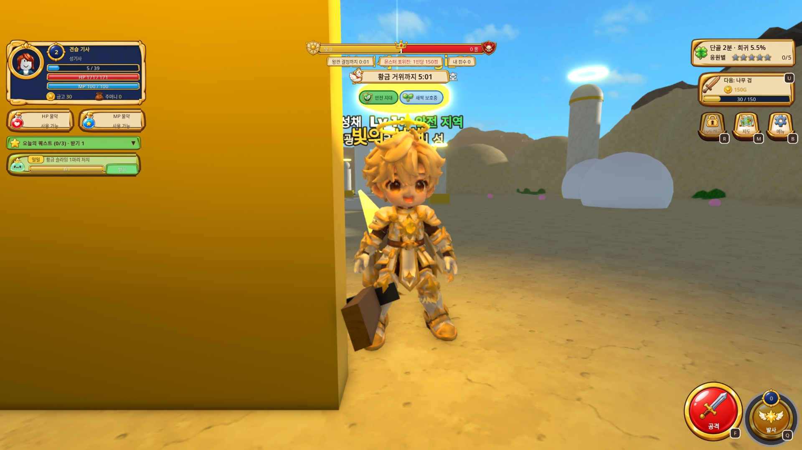
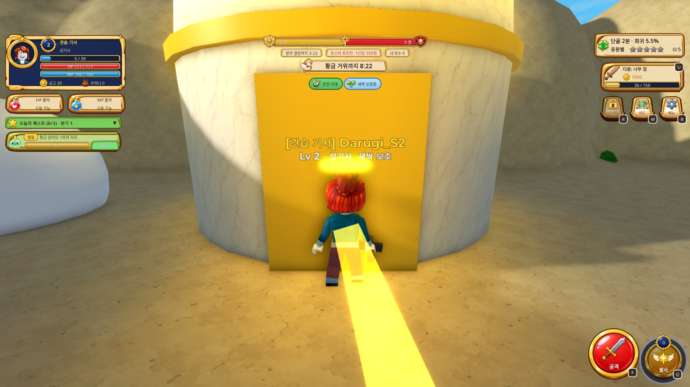
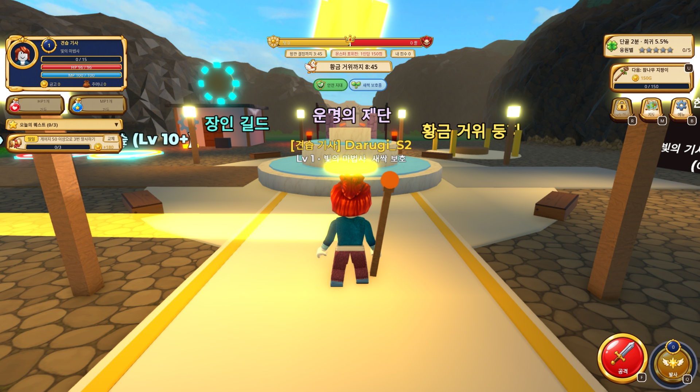

# 성기사 남성 실제 연동·물약 수량 체크포인트

현재 게임용 직업 아바타는 **1/18종**이다. 성기사 남성은 진영·직업 선택만으로 기본 ON 적용되며, B 메뉴 OFF는 사용자의 Roblox 아바타로 복귀한다. 추가 리깅13종/325크레딧과 실제 게임 등록1종을 구분한다.

- 실제 OFF14초/70샘플 중 안정46샘플: XZ 이동0, 속도1미만, Running. 이후 W 이동약25stud·점프 정상. 실제 선택/ON·OFF·다시ON·진짜죽음후ON과 F/Q 관절 움직임 확인.
- 클라이언트 PreloadAsync153콜백 전부Success. 서버 캐시 상태None은 실패로 판정하지 않았다.
- 원래 외형 복귀는 엔진 LoadCharacterWithHumanoidDescriptionAsync를 사용한다. 오프라인28상황365검사는 HP/MP/재고/CD/ForceField기존 인스턴스·만료/발높이·속도/이동기록, 지연·실패·죽음·퇴장·R6/R15 경계를 검사했다. 실제 다른 R6 계정은 아직이다.
- 물약 실제 키1/2는 각2개→1개, 종류별CD설정,0개구매/가득/사용 표시, 제목·상태 TextBounds 정상. 자연 HP/MP회복이 함께 돌아 단순 전후 차이를 물약 회복량이라고 쓰지 않는다.
- 물약 서버929검사, 무기 실제 소스253검사, R15 도구55테스트 통과. 상인·구매화면은 GPT 선택 대기로 꺼져 있으며 실제 NPC 구매는 아직이다.
- 새17종 리깅: 처음10종250, 원본 Head/Body 오브젝트 합치기 뒤 무료검사통과3종 최초리깅75, 합계13종325. 해골30+왕60+pilot25 포함440,API최근잔액4560. 나머지4종은 merged/raw2k 무료검사도false, 유료요청0.
- 새 HaloWarriorF/HaloMageM/HaloMageF rig는 Tripo가 Head재질을 Body재질에 합쳐 얼굴UV가 깨졌다. 원본 fixed의 면·UV·재질 대응 복원 전 업로드하지 않는다.
- HornsMageM/F·NeutralArcherF·악궁수 얼굴 면 분류 복구는 로컬 검증이다. 신규 Importer/실제18종 걷기·점프·활/칼/지팡이 최종 모션은 미완료다.
- 표정7종21장 로컬 확인, 실제 ExpressionAssets등록0. HUD A v2와 물약 상점 시안은 선택대기. 몬스터 옛3종 에셋, BigSlime·닉네임영속성·다인R1 후속도 남았다.

이전 OFF 실패/ownership실험/EditableMesh 미지원 기록은 최초 리깅 실행안에 보존한다. 이번 실제 결과의 근거는 [검증 보고서](verification_2026-10-03/reports/qa_owner_live_result.json), [일반 선택](verification_2026-10-03/reports/production_costume_smoke_actual.json), [프리로드](verification_2026-10-03/reports/pilot_client_preload_actual.json), [물약 키](verification_2026-10-03/reports/potion_native_keys_actual.json)이다.

최신 GoodEvil/Edit 저장: 2026-10-03 23:53:48,7,677,272바이트. 최신39개 소스와 게임용1종을 저장했고 place/GoodEvil.rbxlx 복사본 바이트 일치를 확인했다. 최종15초 Play도 서버23/23·클라이언트9, Luau 런타임 오류0이며 옛 몬스터 에셋 경고는 그대로 기록했다.
