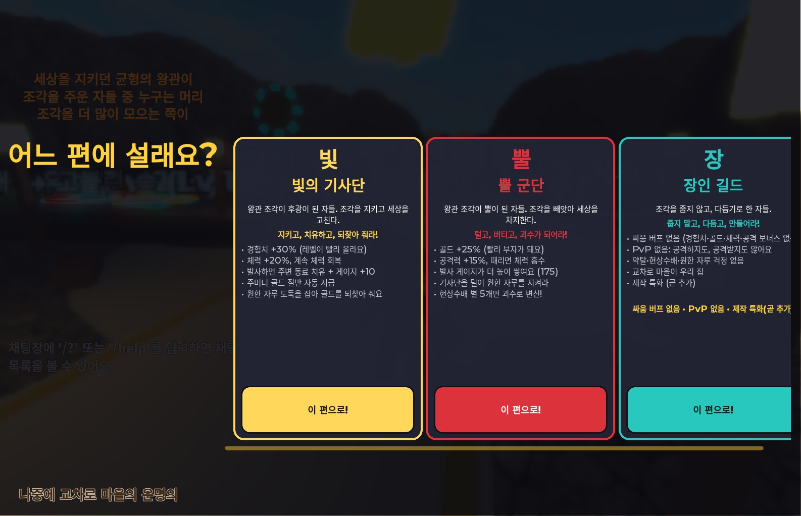
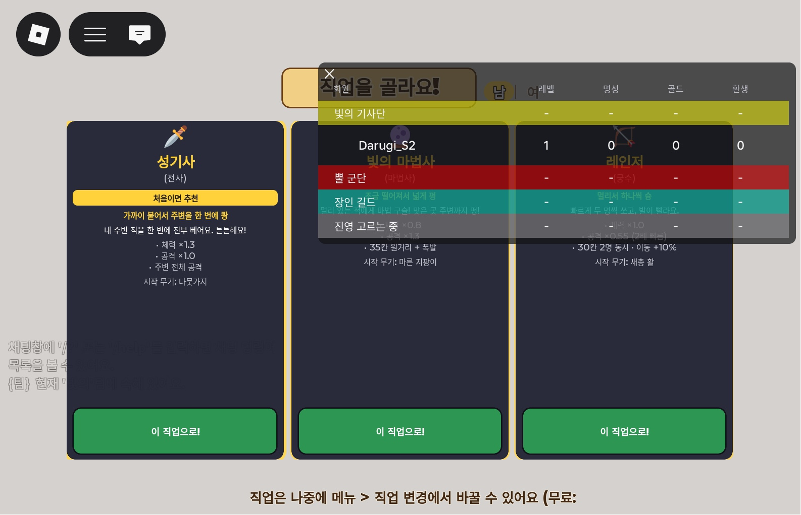
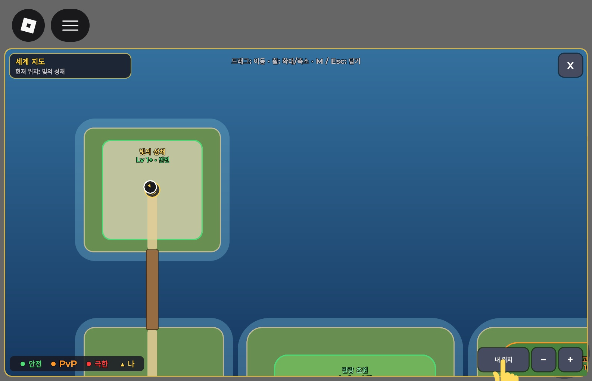
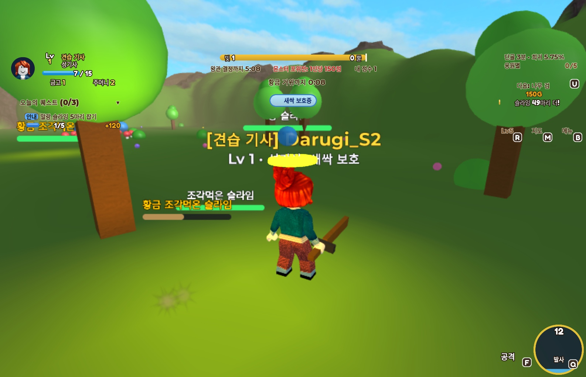
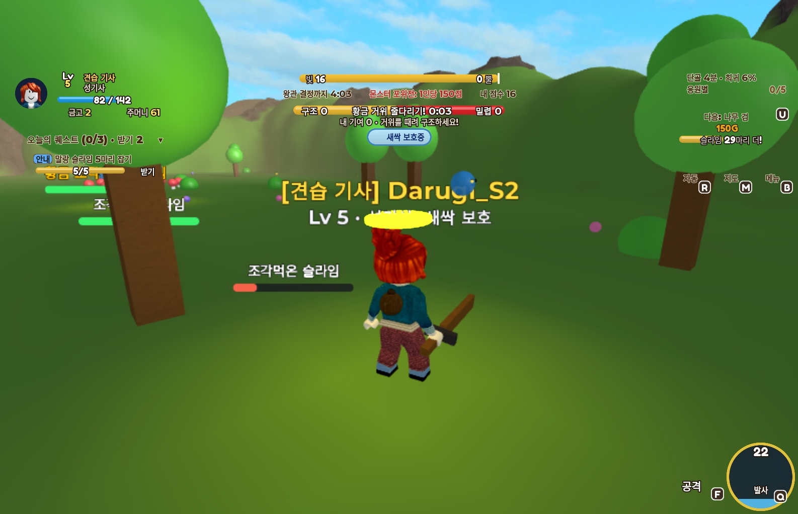
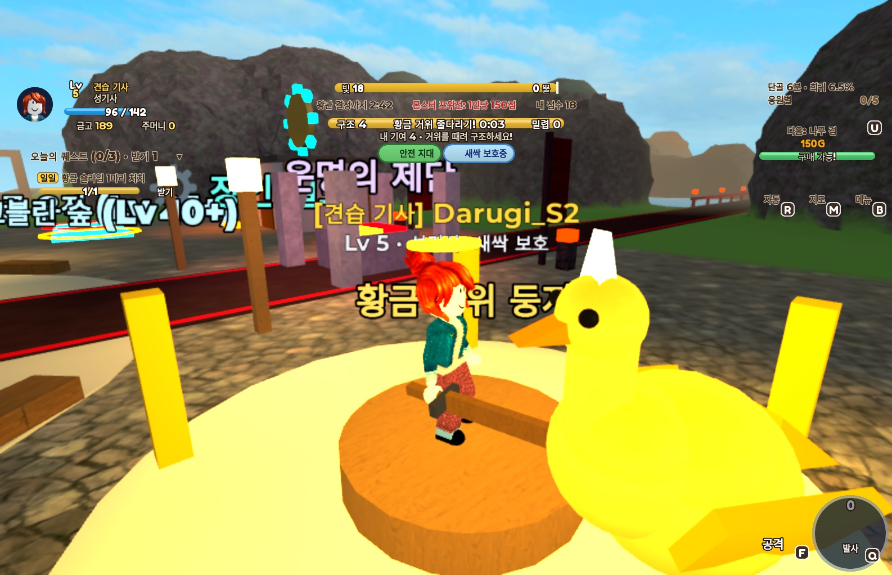
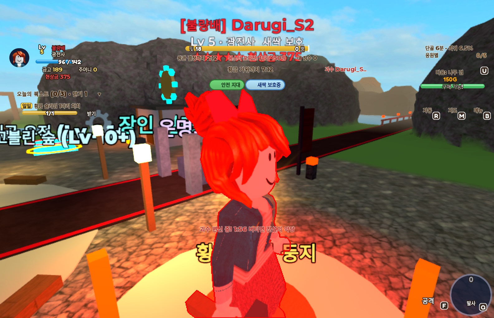

# 코드 리뷰 R1 스튜디오 검증 — 2026-10-03

`git pull` 후 최신 `main` 기준 커밋은 `39a4951`이었다. `GoodEvil`에서 전체 문법 검사와 동기화,
15초 시작 테스트를 거쳐 아래 항목을 실제 화면의 버튼과 키로 확인했다. 단일 플레이 검증이며,
원본 R1의 다인·저장·악용 방지 시나리오 전체를 통과했다는 뜻은 아니다.

## 전체 시작 검사

| 검사 | 결과 |
|---|---|
| `py tools/luau_check.py` | 전체 33개 Luau 파일 문법 정상 |
| `py tools/sync_to_studio.py` | 29개 동기화, 4개 동일 |
| `py tools/playtest.py 15` | 서버 서비스 19/19 정상 시작, ClientMain의 클라이언트 모듈 8개 정상 시작 |
| Luau 런타임 | 이번 시작·기본 플레이 검증에서 오류 없음 |

## 실제 플레이 확인

| 항목 | 조작과 확인 결과 |
|---|---|
| 진영·직업 | 빛의 기사단(Halo) → 성기사(Warrior)를 실제 카드로 선택. 두 선택창이 닫히고 팀이 빛의 기사단으로 변경됨 |
| 이동 | `B` 메뉴의 말랑 초원(SlimeMeadow) 이동 성공 |
| 지도 | `M`으로 열기·닫기, `+` 확대, 내 위치 버튼 정상 동작 |
| 수동 전투 | `F`와 공격 버튼으로 Swing 피해·처치 확인. 골드/XP 보상과 Pain/Hurt 반응 확인 |
| 발사 | `Q`로 Release 실행. Charge 22 → 0, Release Fx 1회 및 히트 2개 확인 |
| 자동 공격 | Studio DebugCommand로 레벨 5 설정 후 `R` 자동 공격 확인. 20초 동안 Swing 13회, 보상 이벤트 6회 |
| 안내 퀘스트 | 실제 처치로 5/5 완료 후 받기를 빠르게 두 번 클릭. 금고 2 → 122, TutorialStep 99, +120골드 한 번만 지급 |
| 황금 거위 | DebugStart로 이벤트를 시작하고 메뉴로 교차로 이동 후 직접 걸어 접근하여 `F` 공격. GooseCount 4, GooseRescue 4 확인 |
| 괴수 | DebugCommand로 뿔 군단과 별 5개 조건 설정. Siren → 10초 뒤 Active, HP 3640, VisualScale 2.08 확인 |

튜토리얼 0단계에서는 일일 퀘스트만 표시한다. 개인 황금슬라임 또는 일반 몬스터 첫 처치 후 안내 단계로,
말랑 초원 진입 후 5마리 안내 퀘스트로 진행한다. 황금슬라임을 남겨 두고 먼저 초원에 이동해도
초원 첫 처치로 진행할 수 있는 기존 계약을 확인했다.

## 남은 검증과 환경 제한

- `Config.AntiCheat.Enforce = false` 유지. 메뉴 이동, 리스폰, 낙하 구조, 덩치 변화, 적 마을 튕김 등의
  이동 오탐 조건 전체와 의도적 비정상 이동 차단은 아직 검증하지 않았다.
- 다인 PvP, 기사단 동료 발사 쿨다운, 괴수 피해/회복 상한, 전쟁 평균 인원,
  자루 환불, 괴수 퇴장 정산 등 원본 R1의 다인 시나리오는 별도 검증이 필요하다.
- DataStore API가 활성화되지 않아 이번 플레이는 메모리 모드였다. 실제 저장·재접속,
  FIFO 경쟁 상황, PairCD의 재접속/서버 이동 유지, 종료 정산은 이번 결과로 확인할 수 없다.
- Developer Product ID가 0이므로 실제 구매·영수증 저장을 검증하지 않았다.
- 옛 계정 Mesh/Texture의 불러오기 실패 경고가 남아 있다. 새 계정으로 재업로드한 에셋 검증은
  2026-10-04부터 별도 진행한다.
- Studio가 비활성 상태인 캡처는 흰 화면이 될 수 있다. 창을 앞에 활성화한 캡처에서는 정상 화면을 확인했다.

## 화면 기록

원본 캡처는 `build/r1_verify/`에 있으며, Git에 보존할 사본은 아래에 둔다.

### 진영 선택

### 직업 선택

### 지도

### 전투

### 퀘스트

### 황금 거위

### 괴수

