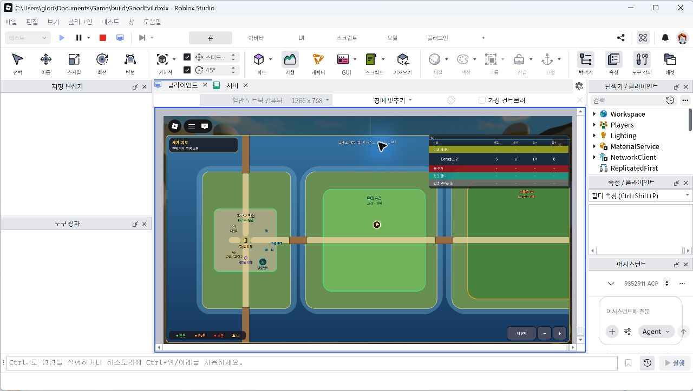
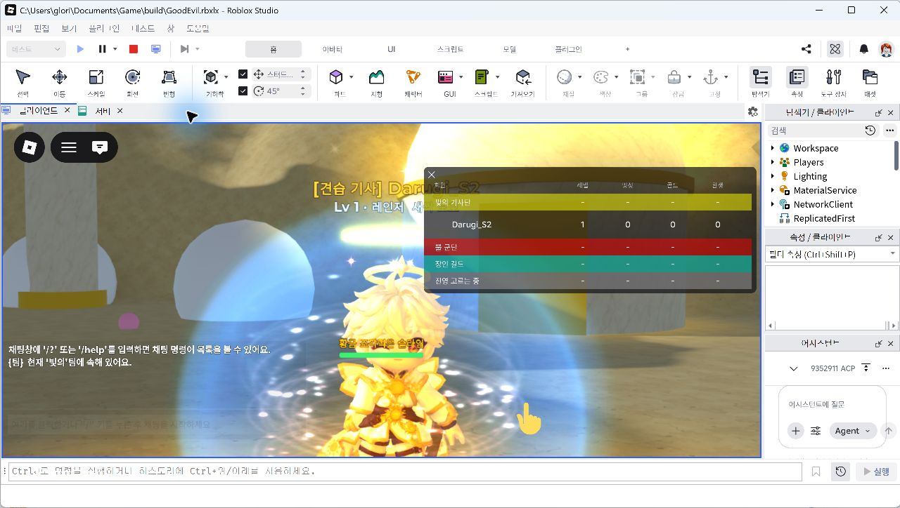
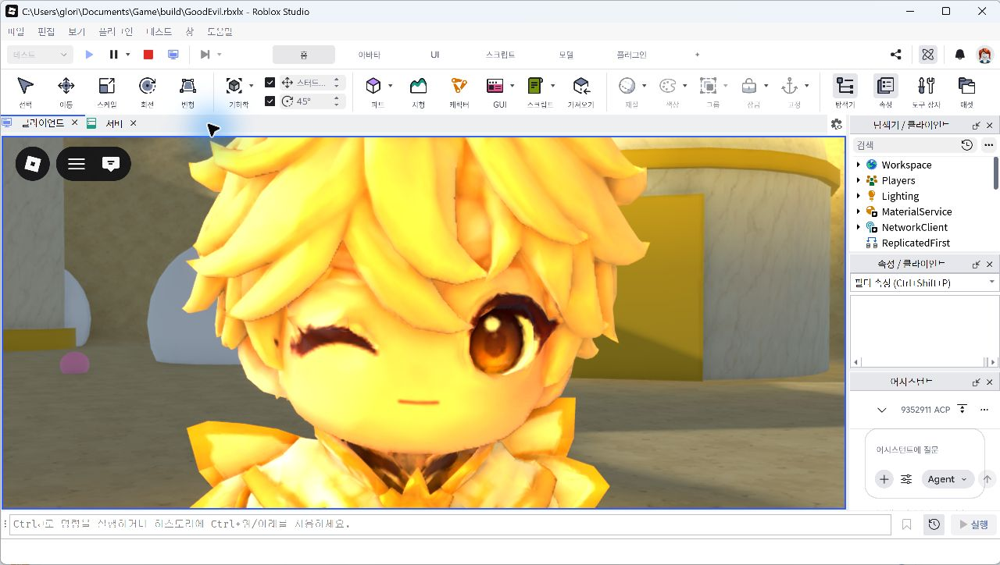
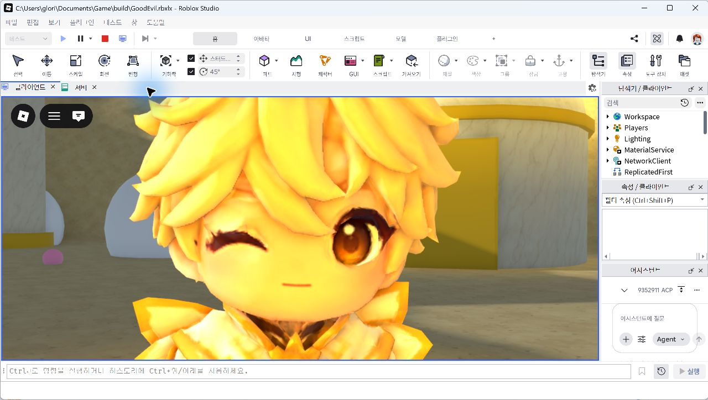
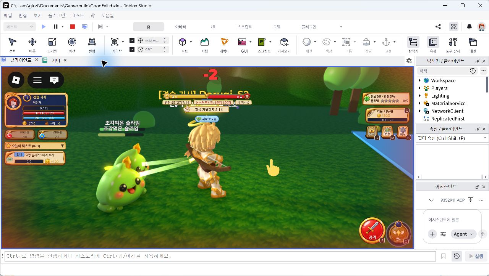

# 코드 리뷰 R1 스튜디오 재검증 — 2026-10-04

> 기록용(2026-10-09 검수): 2026-10-04 검증 기록이다. 충전·발사(Q)·Lv5 자동 공격·치비 코스튬은 그 뒤 바뀌었다 — 수동 + 자동 전투 켜기/끄기(SPEC A23-1·A23-71), 스킬 키 Z·X·C(A23-78), 코스튬 제거(A23-5).

`git pull`은 `Already up to date.`였고 기준은 `main`의 `44cbabf`였다. 기존 미커밋 준비 변경을 보존한 상태로 `GoodEvil`에서 검증했다. 이번 결과는 단일 클라이언트의 기본 플레이와 현재 외형 확인이며, R1 전체 다인·저장·악용 방지 검증 완료를 뜻하지 않는다.

## 전체 시작 검사

| 검사 | 결과 |
|---|---|
| `py tools/luau_check.py` | 전체 42개 Luau 파일 문법 정상 |
| `py tools/sync_to_studio.py` | 변경 0개, 동일 42개 |
| 첫 `py tools/playtest.py 15` | 실제 Play는 시작됐으나 MCP 응답 시간 초과로 `_queue.Empty` 발생. 성공 결과로 집계하지 않음 |
| 화면 활성화 후 `py tools/playtest.py 15` 재실행 | 종료 코드 0, 서버 23/23 서비스 시작, 클라이언트 10개 모듈 시작 |
| Luau 런타임 | 성공한 15초 시작 검사와 아래 기본 플레이 범위에서 오류 없음 |

클라이언트 모듈은 UIKit, Fx, SkinRetargetClient, VitalsUI, HUD, EventHUD, Panels, FactionPicker, ClassPicker, WorldMap이다. `SPEC_ADDENDUM.md`의 A16은 이미 있어 중복 추가하지 않았다.

## 실제 플레이 확인

| 항목 | 조작과 확인 결과 |
|---|---|
| 진영·직업 | 실제 Halo → Warrior 카드 선택 후 코스튬 `Active` 확인 |
| 이동 | `B` 메뉴로 말랑 초원 `SlimeMeadow` 이동 |
| 수동 전투 | `F` 3회 뒤 Charge 6, 처치 1, 소지금 3, XP 7, TutorialStep 2 확인 |
| 발사 | 이어 `F` 2회 후 `Q`: Charge 10 → 0, MP 80, Release Fx 1회, 히트 2개 각 48·화면 합계 96, 처치 3. 후속 UI 확인에서 안내 2/5 표시 |
| 안내 완료 | 추가 실제 `F` 전투 후 처치 9, 소지금 26, Charge 16, 안내 5/5, 금고 1 확인 |
| 받기 중복 방지 | 받기 연속 2회 후 금고 1 → 121, TutorialStep 99, 소지금 26 유지. 안내 보상 120골드 한 번만 지급 |
| 자동 공격 | Studio 전용 `DebugCommand`로 레벨 5 설정 후 `R`, 약 8초 뒤 Auto=true, 처치 11, 소지금 32. Swing Fx 누적 16회 중 probe 시작 시점의 2회를 제외한 증가 14회. 이후 `R`로 해제하고 Stop |
| 지도 | `M` 열기·닫기, `+` 확대, 내 위치 버튼 실제 확인 |

퀘스트 목록은 `QuestsJson` 속성이 아닌 소유자 전용 `Net.Quests` 리모트로 전달한다. 레벨 5는 자동 공격 검증을 위해 Studio 디버그로 설정했으며 일반 진행으로 얻었다고 집계하지 않는다.

## 별도 새 Play의 외형·품질 확인

- 실제 Halo → Archer 선택만으로 코스튬 `Active`, 표정 `Neutral`, 새 Face Mesh 적용을 Native 화면에서 확인했다. Source와 생산 Ready 2종의 등록 내용은 바꾸지 않았다.
- 궁수의 실제 `F` 전투와 슬라임 피격에 따른 플레이어 HP 감소를 Native 화면에서 확인했다.
- 실제 슬라임 `SlimeCustomVisualMesh`의 `Transparency=0`, `LocalTransparencyModifier=0`이며 Native 화면에서 초록색 불투명 외형을 확인했다. 왕슬라임 `BigSlime`의 새 계정 모델은 누락돼 있다.
- 1077×475 뷰포트의 얼굴 확대에서 눈과 세부 경계가 번져 보이는 문제를 확인했다. 품질 Level21 비교와 Play 전용 Bloom OFF 비교를 기록했지만 선명도 해결 완료로 판정하지 않았다. 두 비교 설정은 원복했다.
- Native GraphicsMode는 이번 세션에서 처음 확인했을 때 이미 Automatic이었고 변경하지 않았다. 이전 HANDOFF의 Vulkan 복원 필요 기록과 구분한다. 이번에 임시 변경 후 실제 복원한 것은 QualityLevel=Automatic과 Bloom=true다.

## 남은 검증과 환경 제한

- DataStore를 사용할 수 없어 메모리 모드였다. 닉네임은 `Unavailable`이며 실제 영속 저장·재접속·전 서버 중복 경쟁 검증은 남았다.
- Developer Product ID 0으로 실제 구매·영수증 저장을 검증하지 않았다.
- 옛 Skeleton mesh `97685895938537`와 TexturePack 경고, `MonsterModelArchive`의 옛 고블린 관련 경고가 남았다. 보존 archive 경고를 현재 새 고블린 외형 실패로 집계하지 않는다.
- `Config.AntiCheat.Enforce=false`, 물약 `MerchantEnabled=false`를 유지했다. 다인 PvP, 동료 발사 5초 쿨다운, PairCD 재접속 유지, FIFO 경쟁, 셧다운·괴수 퇴장 정산, 이동 오탐·악용 차단은 이번 기본 플레이 결과로 완료 처리하지 않는다.
- 남은 아바타 16종, 전체 18종 최종 모션, 최종 3D 무기 27종, 나머지 표정·몬스터 새 계정 복구, 물약 NPC 구매, HUD 마무리와 눈 선명도 개선은 미완료다.

## 화면 기록

구조화 결과와 화면 SHA256은 [result.json](r1_verify_2026-10-04/result.json)에 보관한다. 아래 화면은 Native 캡처이며 확대·비교 화면은 전체 모션 품질 승인 근거가 아니다.

### 지도

### 궁수 기본 외형

### 눈·얼굴 확대

### 품질 Level21 비교

### Play 전용 Bloom OFF 비교

### 궁수 전투·불투명 슬라임

